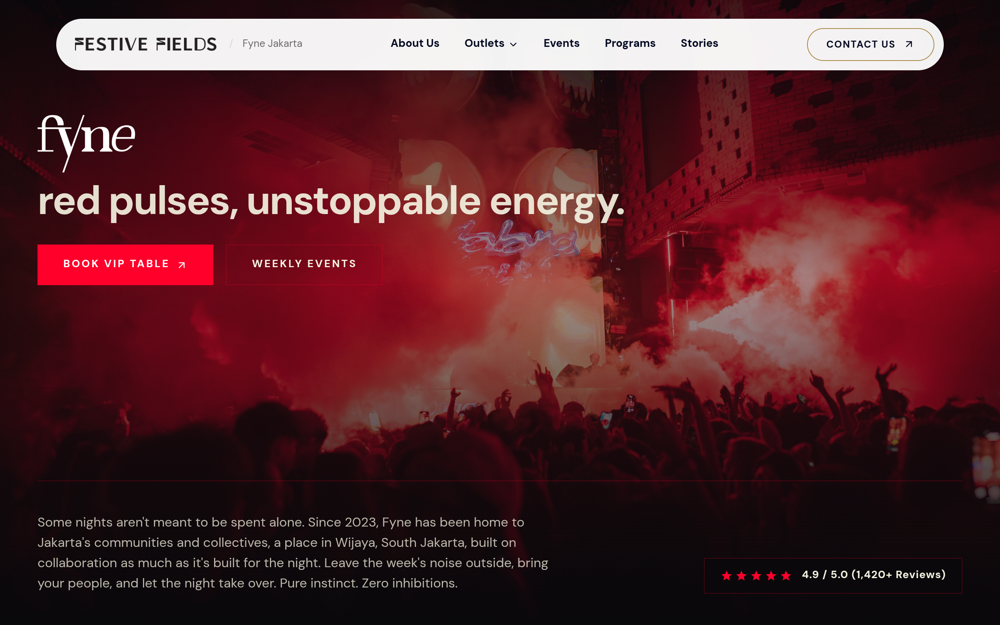

# festive-fields DESIGN.md

> Auto-generated design system — reverse-engineered via static analysis by skillui.
> Frameworks: None detected
> Colors: 20 · Fonts: 3 · Components: 8
> Icon library: not detected · State: not detected
> Primary theme: light · Dark mode toggle: no · Motion: expressive

## Visual Reference

**Match this design exactly** — study colors, fonts, spacing, and component shapes before writing any UI code.



---

## 1. Visual Theme & Atmosphere

This is a **light-themed** interface with a cool, approachable feel. The light background emphasizes content clarity. Typography pairs **__DM_Sans_d9d98a** for display/headings with **__DM_Sans_Fallback_d9d98a** for body text, creating clear visual hierarchy through type contrast. Spacing follows a **4px base grid** (compact density), with scale: 2, 4, 6, 8, 10, 12, 14, 16px. The accent color **#030a22** anchors interactive elements (buttons, links, focus rings). Motion is expressive — spring physics, layout animations, and staggered reveals are part of the visual language.

---

## 2. Color Palette & Roles

| Token | Hex | Role | Use |
|---|---|---|---|
| tw-ring-offset-color | `#ffffff` | background | Page background, darkest surface |
| text-primary | `#e5e7eb` | text-primary | Headings and body text |
| text-primary | `#374151` | text-primary | Headings and body text |
| r-muted | `#6b6b6b` | text-muted | Captions, placeholders, secondary info |
| border | `#5f5f5a` | border | Dividers, card borders, outlines |
| o-on-accent | `#030a22` | accent | CTAs, links, focus rings, active states |
| o-on-accent | `#030a0f` | accent | CTAs, links, focus rings, active states |
| o-on-accent | `#000000` | accent | CTAs, links, focus rings, active states |
| o-accent | `#ff002b` | accent | CTAs, links, focus rings, active states |
| o-accent | `#b32b3b` | accent | CTAs, links, focus rings, active states |
| o-accent | `#38bdf8` | accent | CTAs, links, focus rings, active states |
| o-accent | `#a82b29` | accent | CTAs, links, focus rings, active states |
| o-accent | `#c59b51` | accent | CTAs, links, focus rings, active states |
| o-chip-color | `#4f1c25` | danger | Error states, destructive actions |
| o-ghost-border | `#f4f1e0` | warning | Warning states, caution indicators |
| tw-ring-color | `#3b82f6` | info | Informational highlights |
| unknown | `#a98b4a` | unknown | Palette color |
| unknown | `#826b3a` | unknown | Palette color |
| unknown | `#dddddd` | unknown | Palette color |
| unknown | `#9ca3af` | unknown | Palette color |

### CSS Variable Tokens

```css
--tw-border-spacing-x: 0;
--tw-border-spacing-y: 0;
--tw-border-spacing-x: 0;
--tw-border-spacing-y: 0;
--tw-border-opacity: 1;
--tw-border-opacity: 1;
--tw-border-opacity: 1;
--tw-border-opacity: 1;
--tw-border-opacity: 1;
--tw-border-opacity: 1;
--tw-border-opacity: 1;
--prose-accent: var(--gold);
--prose-accent: var(--r-gold);
--tw-border-opacity: 1;
--tw-border-opacity: 1;
--r-muted: #6b6b6b;
--o-room-card-bg: hsla(0,0%,100%,.03);
--o-dark-accent: var(--o-accent);
--o-dark-on-accent: var(--o-on-accent);
--o-dark-ghost-border: var(--o-ghost-border);
```


---

## 3. Typography Rules

**Font Stack:**
- **__DM_Sans_Fallback_d9d98a** — Heading 1, Heading 2, Heading 3
- **__DM_Sans_d9d98a** — Body, Caption
- **SFMono-Regular** — Code

**Font Sources:**

```css
@font-face {
  font-family: "__DM_Sans_d9d98a";
  src: url("fonts/__DM_Sans_d9d98a-Regular.woff2") format("woff2");
  font-weight: 400;
}
```

| Role | Font | Size | Weight |
|---|---|---|---|
| Heading 1 | __DM_Sans_Fallback_d9d98a | clamp(4rem,7vw,6.5rem) | 700 |
| Heading 2 | __DM_Sans_Fallback_d9d98a | 3.75rem | 700 |
| Heading 3 | __DM_Sans_Fallback_d9d98a | 56px | 700 |
| Body | __DM_Sans_d9d98a | .9375rem | 400 |
| Caption | __DM_Sans_d9d98a | 13px | 400 |
| Code | SFMono-Regular | 14px | 400 |

**Typographic Rules:**
- Limit to 3 font families max per screen
- Use **__DM_Sans_Fallback_d9d98a** for body/UI text, **__DM_Sans_d9d98a** for display/headings
- Maintain consistent hierarchy: no more than 3-4 font sizes per screen
- Headings use bold (600-700), body uses regular (400)
- Line height: 1.5 for body text, 1.2 for headings
- Use color and opacity for secondary hierarchy, not additional font sizes


---

## 4. Component Stylings

### Layout (1)

**Footer** — `html`

### Navigation (1)

**Navigation** — `html`

### Data Display (2)

**Card** — `html`
- Variants: `img`

**Badge** — `html`

### Data Input (1)

**Button** — `html`
- Animation: 

### Overlay (1)

**Modal** — `html`

### Media (2)

**Image** — `html`

**Icon** — `html`


---

## 5. Layout Principles

- **Base spacing unit:** 4px
- **Spacing scale:** 2, 4, 6, 8, 10, 12, 14, 16, 18, 20, 22, 24
- **Border radius:** .25rem, .375rem, .5rem, .75rem, 1.5rem, 4px, 6px, 10px, 14px, 16px, 20px, 22px, 24px, 28px, 999px
- **Max content width:** 992px

**Spacing as Meaning:**
| Spacing | Use |
|---|---|
| 4-8px | Tight: related items within a group |
| 12-16px | Medium: between groups |
| 24-32px | Wide: between sections |
| 48px+ | Vast: major section breaks |


---

## 6. Depth & Elevation

### Raised — cards, buttons, interactive elements

- `0 0 0 3px color-mix(in srgb,var(--gold) 22%,transparent)`
- `0 0 0 3px color-mix(in srgb,var(--gold) 35%,transparent)`

### Overlay — full-screen overlays, top-level dialogs

- `0 18px 40px rgba(0,0,0,.08)`
- `0 18px 50px rgba(3,10,34,.16)`
- `0 30px 80px rgba(3,10,34,.35)`

### Z-Index Scale

`1, 2, 5, 10, 20, 30, 40, 50, 60, 70, 80`


---

## 7. Animation & Motion

This project uses **expressive motion**. Animations are an integral part of the experience.

### CSS Animations

- `@keyframes bounce`
- `@keyframes spin`
- `@keyframes ff-fade-down`
- `@keyframes ff-fade-up`
- `@keyframes r-marquee`
- `@keyframes r-fade`
- `@keyframes r-rise`
- `@keyframes r-kenburns`

### Animated Components

- **Button**: 

### Motion Guidelines

- Duration: 150-300ms for micro-interactions, 300-500ms for page transitions
- Easing: `ease-out` for enters, `ease-in` for exits
- Always respect `prefers-reduced-motion`


---

## 8. Do's and Don'ts

### Do's

- Use `#030a22` for interactive elements (buttons, links, focus rings)
- Use `#ffffff` as the primary page background
- Pair **__DM_Sans_Fallback_d9d98a** (body) with **__DM_Sans_d9d98a** (display) — these are the only allowed fonts
- Follow the **4px** spacing grid for all margins, padding, and gaps
- Use the defined shadow tokens for elevation — see Section 6
- Use border-radius from the scale: .25rem, .375rem, .5rem, .75rem, 1.5rem
- Reuse existing components from Section 4 before creating new ones

### Don'ts

- Don't introduce colors outside this palette — extend the design tokens first
- Don't introduce additional font families beyond __DM_Sans_Fallback_d9d98a and __DM_Sans_d9d98a and SFMono-Regular
- Don't use arbitrary spacing values — stick to multiples of 4px
- Don't create custom box-shadow values outside the system tokens
- Don't use arbitrary border-radius values — pick from the defined scale
- Don't duplicate component patterns — check Section 4 first
- Don't use backdrop-blur or blur effects

### Anti-Patterns (detected from codebase)

- No blur or backdrop-blur effects
- No zebra striping on tables/lists


---

## 9. Responsive Behavior

| Name | Value | Source |
|---|---|---|
| sm | 640px | css |
| md | 767px | css |
| md | 768px | css |
| lg | 1024px | css |
| xl | 1280px | css |
| 2xl | 1536px | css |

**Approach:** Use `@media (min-width: ...)` queries matching the breakpoints above.


---

## 10. Agent Prompt Guide

Use these as starting points when building new UI:

### Build a Card

```
Background: #ffffff
Border: 1px solid #5f5f5a
Radius: 10px
Padding: 16px
Font: __DM_Sans_Fallback_d9d98a
Use shadow tokens from Section 6.
```

### Build a Button

```
Primary: bg #030a22, text white
Ghost: bg transparent, border #5f5f5a
Padding: 8px 16px
Radius: 10px
Hover: opacity 0.9 or lighter shade
Focus: ring with #030a22
```

### Build a Page Layout

```
Background: #ffffff
Max-width: 992px, centered
Grid: 4px base
Responsive: mobile-first, breakpoints from Section 9
```

### Build a Stats Card

```
Surface: #ffffff
Label: #6b6b6b (muted, 12px, uppercase)
Value: #e5e7eb (primary, 24-32px, bold)
Status: use success/warning/danger from Section 2
```

### Build a Form

```
Input bg: #ffffff
Input border: 1px solid #5f5f5a
Focus: border-color #030a22
Label: #6b6b6b 12px
Spacing: 16px between fields
Radius: 10px
```

### General Component

```
1. Read DESIGN.md Sections 2-6 for tokens
2. Colors: only from palette
3. Font: __DM_Sans_Fallback_d9d98a, type scale from Section 3
4. Spacing: 4px grid
5. Components: match patterns from Section 4
6. Elevation: shadow tokens
```
