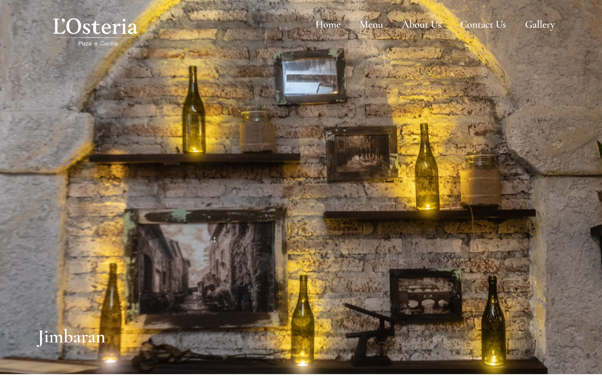

# losteriapizzaecucina Design System

You are building UI for **losteriapizzaecucina**. Light-themed, cool palette, sans-serif typography (Roboto Slab), standard density on a 5px grid, expressive motion.

## Visual Reference

**IMPORTANT**: Study ALL screenshots below before writing any UI. Match colors, typography, spacing, layout, and motion exactly as shown.

### Homepage



> Read `references/DESIGN.md` for full token details.

## Design Philosophy

- **Layered depth** — use shadow tokens to create a sense of physical layering. Each elevation level has a specific shadow.
- **Gradient accents** — gradients are used thoughtfully for emphasis, not decoration.
- **Type pairing** — Roboto Slab for body/UI text, Roboto for headings/display. Never introduce a third typeface.
- **standard density** — 5px base grid. Every dimension is a multiple of 5.
- **cool palette** — the color temperature runs cool, matching the sans-serif typography.
- **Restrained accent** — `#9460ff` is the only pop of color. Used exclusively for CTAs, links, focus rings, and active states.
- **Expressive motion** — animations are an integral part of the experience. Use spring physics and layout animations.

## Color System

### Core Palette

| Role | Token | Hex | Use |
|------|-------|-----|-----|
| Background | `--background` | `#eeeeee` | Page/app background |
| Surface | `--surface` | `#f9efdc` | Cards, panels, modals |
| Text Primary | `--text-primary` | `#000000` | Headings, body text |
| Text Muted | `--text-muted` | `#ffffff` | Captions, placeholders |
| Accent | `--accent` | `#9460ff` | CTAs, links, focus rings |
| Border | `--border` | `#333333` | Dividers, card borders |

### Status Colors

| Status | Hex | Use |
|--------|-----|-----|
| Success | `#53f8a2` | Confirmations, positive trends |
| Danger | `#fe8f75` | Errors, destructive actions |

### Extended Palette

- `#2575fc`
- **e-global-color-ed889b2:** `#69727d`
- **divider-color:** `#d5d5d5`
- **n-menu-title-color-normal:** `#1f2124`
- **e-global-color-primary:** `#6ec1e4`
- `#4285f4`
- `#f2709c`
- **e-global-color-text:** `#7a7a7a`

### CSS Variable Tokens

```css
--border-radius: 0;
--border-top-width: 0px;
--border-right-width: 0px;
--border-bottom-width: 0px;
--border-left-width: 0px;
--border-style: initial;
--border-color: initial;
--border-block-start-width: var(--border-top-width);
--border-block-end-width: var(--border-bottom-width);
--border-inline-start-width: var(--border-left-width);
--border-inline-end-width: var(--border-right-width);
--border-inline-start-width: var(--border-right-width);
--border-inline-end-width: var(--border-left-width);
--e-global-color-primary: #6EC1E4;
--e-global-color-secondary: #54595F;
--e-global-color-accent: #61CE70;
--e-global-typography-primary-font-family: "Roboto";
--e-global-typography-primary-font-weight: 600;
--e-global-typography-secondary-font-family: "Roboto Slab";
--e-global-typography-secondary-font-weight: 400;
```

## Typography

### Font Stack

- **Roboto Slab** — Heading 1, Heading 2, Heading 3
- **Roboto** — Body, Caption
- **Courier New** — Code

### Font Sources

```css
@font-face {
  font-family: "eicons";
  src: url("fonts/eicons-Regular.woff2") format("woff2");
  font-weight: 400;
}
@font-face {
  font-family: "Roboto";
  src: url("fonts/Roboto-Bold.ttf") format("truetype");
  font-weight: 700;
}
@font-face {
  font-family: "Roboto";
  src: url("fonts/Roboto-Regular.ttf") format("truetype");
  font-weight: 400;
}
@font-face {
  font-family: "Roboto Slab";
  src: url("fonts/RobotoSlab-Bold.ttf") format("truetype");
  font-weight: 700;
}
@font-face {
  font-family: "Roboto Slab";
  src: url("fonts/RobotoSlab-Regular.ttf") format("truetype");
  font-weight: 400;
}
@font-face {
  font-family: "Cormorant Garamond";
  src: url("fonts/CormorantGaramond-Bold.ttf") format("truetype");
  font-weight: 700;
}
@font-face {
  font-family: "Cormorant Garamond";
  src: url("fonts/CormorantGaramond-Regular.ttf") format("truetype");
  font-weight: 400;
}
@font-face {
  font-family: "elementskit";
  src: url("fonts/elementskit-Regular.woff") format("woff");
  font-weight: 400;
}
```

### Type Scale

| Role | Family | Size | Weight |
|------|--------|------|--------|
| Heading 1 | Roboto Slab | 132px | 700 |
| Heading 2 | Roboto Slab | 100px | 700 |
| Heading 3 | Roboto Slab | 90px | 700 |
| Body | Roboto | 14px | 400 |
| Caption | Roboto | 18px | 400 |
| Code | Courier New | 14px | 400 |

### Typography Rules

- Body/UI: **Roboto Slab**, Headings: **Roboto** — these are the only display fonts
- Max 3-4 font sizes per screen
- Headings: weight 600-700, body: weight 400
- Use color and opacity for text hierarchy, not additional font sizes
- Line height: 1.5 for body, 1.2 for headings

## Spacing & Layout

### Base Grid: 5px

Every dimension (margin, padding, gap, width, height) must be a multiple of **5px**.

### Spacing Scale

`5, 10, 15, 20, 25, 30, 35, 40, 45, 50, 55, 60` px

### Spacing as Meaning

| Spacing | Use |
|---------|-----|
| 2.5-5px | Tight: related items within a group |
| 10px | Medium: between groups |
| 15-20px | Wide: between sections |
| 30px+ | Vast: major section breaks |

### Border Radius

Scale: `.1em, .25rem, .5em, 2px, 2rem, 3px, 4px, 4.32px, 5px, 6px, 10em, 10%, 10px, 14px, 15px, 17.5px, 20px, 25px, 30px, 50px, 100%, 100em, 100px, 1000px, inherit`
Default: `10px`

### Container

Max-width: `1024px`, centered with auto margins.

### Breakpoints

| Name | Value |
|------|-------|
| xs | 320px |
| xs | 411px |
| xs | 479px |
| xs | 480px |
| sm | 481px |
| sm | 568px |
| sm | 575px |
| sm | 576px |
| sm | 640px |
| md | 766px |
| md | 767px |
| md | 768px |
| lg | 800px |
| lg | 900px |
| lg | 991px |
| lg | 992px |
| lg | 1023px |
| lg | 1024px |
| xl | 1025px |
| xl | 1199px |
| xl | 1200px |
| 2xl | 99999px |

Mobile-first: design for small screens, layer on responsive overrides.

## Component Patterns

### Card

```css
.card {
  background: #f9efdc;
  border: 1px solid #333333;
  border-radius: 10px;
  padding: 20px;
  box-shadow: 0 .35rem 0 currentColor;
}
```

```html
<div class="card">
  <h3>Card Title</h3>
  <p>Card content goes here.</p>
</div>
```

### Button

```css
/* Primary */
.btn-primary {
  background: #9460ff;
  color: #000000;
  border-radius: 10px;
  padding: 10px 20px;
  font-weight: 500;
  transition: opacity 150ms ease;
}
.btn-primary:hover { opacity: 0.9; }

/* Ghost */
.btn-ghost {
  background: transparent;
  border: 1px solid #333333;
  color: #000000;
  border-radius: 10px;
  padding: 10px 20px;
}
```

```html
<button class="btn-primary">Get Started</button>
<button class="btn-ghost">Learn More</button>
```

### Input

```css
.input {
  background: #eeeeee;
  border: 1px solid #333333;
  border-radius: 10px;
  padding: 10px 15px;
  color: #000000;
  font-size: 14px;
}
.input:focus { border-color: #9460ff; outline: none; }
```

```html
<input class="input" type="text" placeholder="Search..." />
```

### Badge / Chip

```css
.badge {
  display: inline-flex;
  align-items: center;
  padding: 5px 10px;
  border-radius: 9999px;
  font-size: 12px;
  font-weight: 500;
  background: #f9efdc;
  color: #ffffff;
}
```

```html
<span class="badge">New</span>
<span class="badge">Beta</span>
```

### Modal / Dialog

```css
.modal-backdrop { background: rgba(0, 0, 0, 0.6); }
.modal {
  background: #f9efdc;
  border: 1px solid #333333;
  border-radius: inherit;
  padding: 30px;
  max-width: 480px;
  width: 90vw;
  box-shadow: 0 4px 10px -2px rgba(0,0,0,0.1);
}
```

```html
<div class="modal-backdrop">
  <div class="modal">
    <h2>Dialog Title</h2>
    <p>Dialog content.</p>
    <button class="btn-primary">Confirm</button>
    <button class="btn-ghost">Cancel</button>
  </div>
</div>
```

### Table

```css
.table { width: 100%; border-collapse: collapse; }
.table th {
  text-align: left;
  padding: 10px 15px;
  font-weight: 500;
  font-size: 12px;
  color: #ffffff;
  text-transform: uppercase;
  letter-spacing: 0.05em;
  border-bottom: 1px solid #333333;
}
.table td {
  padding: 15px;
  border-bottom: 1px solid #333333;
}
```

```html
<table class="table">
  <thead><tr><th>Name</th><th>Status</th><th>Date</th></tr></thead>
  <tbody>
    <tr><td>Item One</td><td>Active</td><td>Jan 1</td></tr>
    <tr><td>Item Two</td><td>Pending</td><td>Jan 2</td></tr>
  </tbody>
</table>
```

### Navigation

```css
.nav {
  display: flex;
  align-items: center;
  gap: 10px;
  padding: 15px 20px;
  border-bottom: 1px solid #333333;
}
.nav-link {
  color: #ffffff;
  padding: 10px 15px;
  border-radius: 10px;
  transition: color 150ms;
}
.nav-link:hover { color: #000000; }
.nav-link.active { color: #9460ff; }
```

```html
<nav class="nav">
  <a href="/" class="nav-link active">Home</a>
  <a href="/about" class="nav-link">About</a>
  <a href="/pricing" class="nav-link">Pricing</a>
  <button class="btn-primary" style="margin-left: auto">Get Started</button>
</nav>
```

### Extracted Components

These components were found in the codebase:

**Navigation** (`html`)

## Page Structure

The following page sections were detected:

- **Navigation** — Top navigation bar (5 items)
- **Hero** — Hero section (detected from heading structure)
- **Footer** — Page footer with links and info (3 items)

When building pages, follow this section order and structure.

## Animation & Motion

This project uses **expressive motion**. Animations are part of the design language.

### CSS Animations

- `a`
- `eicon-spin`
- `fadeInUp`
- `fadeIn`
- `fa-spin`

### Motion Tokens

- **Duration scale:** `0s`, `0ms`, `.3s`, `.35s`, `.5s`, `.75s`, `1s`, `1.25s`, `1.5s`, `2ms`, `2s`, `9s`, `10s`, `20ms`, `20s`, `100ms`, `120ms`, `150ms`, `180ms`, `200ms`, `220ms`, `250ms`, `300ms`, `350ms`, `400ms`, `500ms`, `600ms`, `700ms`, `800ms`, `1000ms`, `1200ms`, `2000ms`, `5000ms`
- **Easing functions:** `ease-in`, `ease-out`, `cubic-bezier(0,1,0.5,1)`, `cubic-bezier(0.58,0.3,0.005,1)`, `cubic-bezier(0.25,0.5,0.5,0.9)`, `linear`, `ease-in-out`, `cubic-bezier(.58,.3,.005,1)`, `ease`, `cubic-bezier(.6,.1,.68,.53)`, `cubic-bezier(.22,.61,.24,1)`, `cubic-bezier(0,1,0,1)`, `cubic-bezier(0,.9,.7,1.45)`, `cubic-bezier(.55,.055,.675,.19)`, `cubic-bezier(.175,.885,.32,1)`, `cubic-bezier(.215,.61,.355,1)`, `cubic-bezier(.9,.03,0,.96)`

### Motion Guidelines

- **Duration:** Use values from the duration scale above. Short (0s) for micro-interactions, long (5000ms) for page transitions
- **Easing:** Use `ease-in` as the default easing curve
- **Direction:** Elements enter from bottom/right, exit to top/left
- **Reduced motion:** Always respect `prefers-reduced-motion` — disable animations when set

## Depth & Elevation

### Shadow Tokens

- Subtle: `inset 0 0 0 1px rgba(0,0,0,.1)`
- Subtle: `inset 0-1px 0 rgba(0,0,0,.102)`
- Subtle: `inset 0 0 0 1px currentColor`
- Subtle: `0 0 0 2px rgba(51,51,51,.1)`
- Raised (cards, buttons): `0 .35rem 0 currentColor`
- Raised (cards, buttons): `var(--n-menu-dropdown-content-box-shadow-horizontal) var(--n-menu-dropdown-content-box-shadow-vertical) var(--n-menu-dropdown-content-box-shadow-blur) var(--n-menu-dropdown-content-box-shadow-spread) var(--n-menu-dropdown-content-box-shadow-color) var(--n-menu-dropdown-content-box-shadow-position, )`

### Z-Index Scale

`0, 1, 2, 3, 5, 6, 9, 10, 11, 12, 14, 16, 20, 21, 25, 30, 40, 50, 99, 100, 101, 102, 150, 160, 999, 1000, 1002, 1044, 1045, 1046, 1070, 1111, 2001, 2002, 9997, 9999, 10000, 90000, 99999, 100000, 999998, 999999, 2147483620, 2147483640`

Use these exact values — never invent z-index values.

## Anti-Patterns (Never Do)

- **No blur effects** — no backdrop-blur, no filter: blur()
- **No zebra striping** — tables and lists use borders for separation
- **No invented colors** — every hex value must come from the palette above
- **No arbitrary spacing** — every dimension is a multiple of 5px
- **No extra fonts** — only Roboto Slab and Roboto and Courier New are allowed
- **No arbitrary border-radius** — use the scale: .1em, .25rem, .5em, 2px, 2rem, 3px, 4px, 4.32px, 5px, 6px
- **No opacity for disabled states** — use muted colors instead

## Workflow

1. **Read** `references/DESIGN.md` before writing any UI code
2. **Pick colors** from the Color System section — never invent new ones
3. **Set typography** — Roboto Slab, Roboto, Courier New only, using the type scale
4. **Build layout** on the 5px grid — check every margin, padding, gap
5. **Match components** to patterns above before creating new ones
6. **Apply elevation** — use shadow tokens
7. **Validate** — every value traces back to a design token. No magic numbers.

## Brand Spec

- **Favicon:** `https://losteriapizzaecucina.com/wp-content/uploads/2026/02/cropped-LOsteria-Logo-Jkt-32x32.png`
- **Site URL:** `https://losteriapizzaecucina.com/jimbaran/`
- **Brand color:** `#9460ff`
- **Brand typeface:** Roboto Slab

## Quick Reference

```
Background:     #eeeeee
Surface:        #f9efdc
Text:           #000000 / #ffffff
Accent:         #9460ff
Border:         #333333
Font:           Roboto Slab
Spacing:        5px grid
Radius:         10px
Components:     8 detected
```

## When to Trigger

Activate this skill when:
- Creating new components, pages, or visual elements for losteriapizzaecucina
- Writing CSS, Tailwind classes, styled-components, or inline styles
- Building page layouts, templates, or responsive designs
- Reviewing UI code for design consistency
- The user mentions "losteriapizzaecucina" design, style, UI, or theme
- Generating mockups, wireframes, or visual prototypes

---

# Full Reference Files

> Every output file is embedded below. Claude has full design system context from /skills alone.

## Design System Tokens (DESIGN.md)

# losteriapizzaecucina DESIGN.md

> Auto-generated design system — reverse-engineered via static analysis by skillui.
> Frameworks: None detected
> Colors: 20 · Fonts: 3 · Components: 8
> Icon library: not detected · State: not detected
> Primary theme: light · Dark mode toggle: no · Motion: expressive

## Visual Reference

**Match this design exactly** — study colors, fonts, spacing, and component shapes before writing any UI code.


---

## 1. Visual Theme & Atmosphere

This is a **light-themed** interface with a cool, approachable feel. The light background emphasizes content clarity. Typography pairs **Roboto** for display/headings with **Roboto Slab** for body text, creating clear visual hierarchy through type contrast. Spacing follows a **5px base grid** (standard density), with scale: 5, 10, 15, 20, 25, 30, 35, 40px. The accent color **#9460ff** anchors interactive elements (buttons, links, focus rings). Motion is expressive — spring physics, layout animations, and staggered reveals are part of the visual language.

---

## 2. Color Palette & Roles

| Token | Hex | Role | Use |
|---|---|---|---|
| background | `#eeeeee` | background | Page background, darkest surface |
| surface | `#f9efdc` | surface | Card and panel backgrounds |
| wp--preset--color--black | `#000000` | text-primary | Headings and body text |
| e-form-steps-indicator-inactive-secondary-color | `#ffffff` | text-muted | Captions, placeholders, secondary info |
| text-muted | `#494c4f` | text-muted | Captions, placeholders, secondary info |
| e-global-color-secondary | `#55595c` | text-muted | Captions, placeholders, secondary info |
| border | `#333333` | border | Dividers, card borders, outlines |
| accent | `#9460ff` | accent | CTAs, links, focus rings, active states |
| danger | `#fe8f75` | danger | Error states, destructive actions |
| success | `#53f8a2` | success | Success states, positive indicators |
| info | `#2575fc` | info | Informational highlights |
| e-global-color-ed889b2 | `#69727d` | unknown | Palette color |
| divider-color | `#d5d5d5` | unknown | Palette color |
| n-menu-title-color-normal | `#1f2124` | unknown | Palette color |
| e-global-color-primary | `#6ec1e4` | unknown | Palette color |
| unknown | `#4285f4` | unknown | Palette color |
| unknown | `#f2709c` | unknown | Palette color |
| e-global-color-text | `#7a7a7a` | unknown | Palette color |
| unknown | `#ff712b` | unknown | Palette color |
| unknown | `#00e49a` | unknown | Palette color |

### CSS Variable Tokens

```css
--border-radius: 0;
--border-top-width: 0px;
--border-right-width: 0px;
--border-bottom-width: 0px;
--border-left-width: 0px;
--border-style: initial;
--border-color: initial;
--border-block-start-width: var(--border-top-width);
--border-block-end-width: var(--border-bottom-width);
--border-inline-start-width: var(--border-left-width);
--border-inline-end-width: var(--border-right-width);
--border-inline-start-width: var(--border-right-width);
--border-inline-end-width: var(--border-left-width);
--e-global-color-primary: #6EC1E4;
--e-global-color-secondary: #54595F;
--e-global-color-accent: #61CE70;
--e-global-typography-primary-font-family: "Roboto";
--e-global-typography-primary-font-weight: 600;
--e-global-typography-secondary-font-family: "Roboto Slab";
--e-global-typography-secondary-font-weight: 400;
```


---

## 3. Typography Rules

**Font Stack:**
- **Roboto Slab** — Heading 1, Heading 2, Heading 3
- **Roboto** — Body, Caption
- **Courier New** — Code

**Font Sources:**

```css
@font-face {
  font-family: "eicons";
  src: url("fonts/eicons-Regular.woff2") format("woff2");
  font-weight: 400;
}
@font-face {
  font-family: "Roboto";
  src: url("fonts/Roboto-Bold.ttf") format("truetype");
  font-weight: 700;
}
@font-face {
  font-family: "Roboto";
  src: url("fonts/Roboto-Regular.ttf") format("truetype");
  font-weight: 400;
}
@font-face {
  font-family: "Roboto Slab";
  src: url("fonts/RobotoSlab-Bold.ttf") format("truetype");
  font-weight: 700;
}
@font-face {
  font-family: "Roboto Slab";
  src: url("fonts/RobotoSlab-Regular.ttf") format("truetype");
  font-weight: 400;
}
@font-face {
  font-family: "Cormorant Garamond";
  src: url("fonts/CormorantGaramond-Bold.ttf") format("truetype");
  font-weight: 700;
}
@font-face {
  font-family: "Cormorant Garamond";
  src: url("fonts/CormorantGaramond-Regular.ttf") format("truetype");
  font-weight: 400;
}
@font-face {
  font-family: "elementskit";
  src: url("fonts/elementskit-Regular.woff") format("woff");
  font-weight: 400;
}
```

| Role | Font | Size | Weight |
|---|---|---|---|
| Heading 1 | Roboto Slab | 132px | 700 |
| Heading 2 | Roboto Slab | 100px | 700 |
| Heading 3 | Roboto Slab | 90px | 700 |
| Body | Roboto | 14px | 400 |
| Caption | Roboto | 18px | 400 |
| Code | Courier New | 14px | 400 |

**Typographic Rules:**
- Limit to 3 font families max per screen
- Use **Roboto Slab** for body/UI text, **Roboto** for display/headings
- Maintain consistent hierarchy: no more than 3-4 font sizes per screen
- Headings use bold (600-700), body uses regular (400)
- Line height: 1.5 for body text, 1.2 for headings
- Use color and opacity for secondary hierarchy, not additional font sizes


---

## 4. Component Stylings

### Layout (1)

**Footer** — `html`

### Navigation (1)

**Navigation** — `html`

### Data Display (1)

**Badge** — `html`

### Data Input (2)

**Button** — `html`
- Animation: 

**Input** — `html`
- State: :focus, :placeholder

### Overlay (1)

**Modal** — `html`

### Media (2)

**Image** — `html`

**Map/Canvas** — `html`


---

## 5. Layout Principles

- **Base spacing unit:** 5px
- **Spacing scale:** 5, 10, 15, 20, 25, 30, 35, 40, 45, 50, 55, 60
- **Border radius:** .1em, .25rem, .5em, 2px, 2rem, 3px, 4px, 4.32px, 5px, 6px, 10em, 10%, 10px, 14px, 15px, 17.5px, 20px, 25px, 30px, 50px, 100%, 100em, 100px, 1000px, inherit
- **Max content width:** 1024px

**Spacing as Meaning:**
| Spacing | Use |
|---|---|
| 2.5-5px | Tight: related items within a group |
| 10px | Medium: between groups |
| 15-20px | Wide: between sections |
| 30px+ | Vast: major section breaks |


---

## 6. Depth & Elevation

### Flat — subtle depth hints

- `inset 0 0 0 1px rgba(0,0,0,.1)`
- `inset 0-1px 0 rgba(0,0,0,.102)`
- `inset 0 0 0 1px currentColor`

### Raised — cards, buttons, interactive elements

- `0 .35rem 0 currentColor`
- `var(--n-menu-dropdown-content-box-shadow-horizontal) var(--n-menu-dropdown-content-box-shadow-vertical) var(--n-menu-dropdown-content-box-shadow-blur) var(--n-menu-dropdown-content-box-shadow-spread) var(--n-menu-dropdown-content-box-shadow-color) var(--n-menu-dropdown-content-box-shadow-position, )`
- `0 0 8px rgba(0,0,0,.6)`

### Floating — dropdowns, popovers, modals

- `0 4px 10px -2px rgba(0,0,0,0.1)`
- `0 0 12px rgba(51,51,51,.5)`
- `0 3px 0#fff,0 0 12px rgba(51,51,51,.5)`

### Overlay — full-screen overlays, top-level dialogs

- `0 10px 30px 0 rgba(45,45,45,.2)`
- `0 10px 30px 0 rgba(255,165,0,0)`
- `0 10px 25px rgba(0,0,0,.1)`

### Z-Index Scale

`0, 1, 2, 3, 5, 6, 9, 10, 11, 12, 14, 16, 20, 21, 25, 30, 40, 50, 99, 100, 101, 102, 150, 160, 999, 1000, 1002, 1044, 1045, 1046, 1070, 1111, 2001, 2002, 9997, 9999, 10000, 90000, 99999, 100000, 999998, 999999, 2147483620, 2147483640`


---

## 7. Animation & Motion

This project uses **expressive motion**. Animations are an integral part of the experience.

### CSS Animations

- `@keyframes a`
- `@keyframes eicon-spin`
- `@keyframes fadeInUp`
- `@keyframes fadeIn`
- `@keyframes fa-spin`
- `@keyframes hide-scroll`
- `@keyframes ekit_ajax_spinner_rotation`
- `@keyframes xs-zoomIn`

### Animated Components

- **Button**: 

### Motion Guidelines

- Duration: 150-300ms for micro-interactions, 300-500ms for page transitions
- Easing: `ease-out` for enters, `ease-in` for exits
- Always respect `prefers-reduced-motion`


---

## 8. Do's and Don'ts

### Do's

- Use `#9460ff` for interactive elements (buttons, links, focus rings)
- Use `#eeeeee` as the primary page background
- Pair **Roboto Slab** (body) with **Roboto** (display) — these are the only allowed fonts
- Follow the **5px** spacing grid for all margins, padding, and gaps
- Use the defined shadow tokens for elevation — see Section 6
- Use border-radius from the scale: .1em, .25rem, .5em, 2px, 2rem
- Reuse existing components from Section 4 before creating new ones

### Don'ts

- Don't introduce colors outside this palette — extend the design tokens first
- Don't introduce additional font families beyond Roboto Slab and Roboto and Courier New
- Don't use arbitrary spacing values — stick to multiples of 5px
- Don't create custom box-shadow values outside the system tokens
- Don't use arbitrary border-radius values — pick from the defined scale
- Don't duplicate component patterns — check Section 4 first
- Don't use backdrop-blur or blur effects

### Anti-Patterns (detected from codebase)

- No blur or backdrop-blur effects
- No zebra striping on tables/lists


---

## 9. Responsive Behavior

| Name | Value | Source |
|---|---|---|
| xs | 320px | css |
| xs | 411px | css |
| xs | 479px | css |
| xs | 480px | css |
| sm | 481px | css |
| sm | 568px | css |
| sm | 575px | css |
| sm | 576px | css |
| sm | 640px | css |
| md | 766px | css |
| md | 767px | css |
| md | 768px | css |
| lg | 800px | css |
| lg | 900px | css |
| lg | 991px | css |
| lg | 992px | css |
| lg | 1023px | css |
| lg | 1024px | css |
| xl | 1025px | css |
| xl | 1199px | css |
| xl | 1200px | css |
| 2xl | 99999px | css |

**Approach:** Use `@media (min-width: ...)` queries matching the breakpoints above.


---

## 10. Agent Prompt Guide

Use these as starting points when building new UI:

### Build a Card

```
Background: #f9efdc
Border: 1px solid #333333
Radius: 10px
Padding: 20px
Font: Roboto Slab
Use shadow tokens from Section 6.
```

### Build a Button

```
Primary: bg #9460ff, text white
Ghost: bg transparent, border #333333
Padding: 10px 20px
Radius: 10px
Hover: opacity 0.9 or lighter shade
Focus: ring with #9460ff
```

### Build a Page Layout

```
Background: #eeeeee
Max-width: 1024px, centered
Grid: 5px base
Responsive: mobile-first, breakpoints from Section 9
```

### Build a Stats Card

```
Surface: #f9efdc
Label: #ffffff (muted, 12px, uppercase)
Value: #000000 (primary, 24-32px, bold)
Status: use success/warning/danger from Section 2
```

### Build a Form

```
Input bg: #eeeeee
Input border: 1px solid #333333
Focus: border-color #9460ff
Label: #ffffff 12px
Spacing: 20px between fields
Radius: 10px
```

### General Component

```
1. Read DESIGN.md Sections 2-6 for tokens
2. Colors: only from palette
3. Font: Roboto Slab, type scale from Section 3
4. Spacing: 5px grid
5. Components: match patterns from Section 4
6. Elevation: shadow tokens
```

## Bundled Fonts (fonts/)

The following font files are bundled in the `fonts/` directory:

- `fonts/CormorantGaramond-Bold.ttf`
- `fonts/CormorantGaramond-Light.ttf`
- `fonts/CormorantGaramond-Medium.ttf`
- `fonts/CormorantGaramond-Regular.ttf`
- `fonts/CormorantGaramond-SemiBold.ttf`
- `fonts/Roboto-Black.ttf`
- `fonts/Roboto-Bold.ttf`
- `fonts/Roboto-ExtraBold.ttf`
- `fonts/Roboto-ExtraLight.ttf`
- `fonts/Roboto-Light.ttf`
- `fonts/Roboto-Medium.ttf`
- `fonts/Roboto-Regular.ttf`
- `fonts/Roboto-SemiBold.ttf`
- `fonts/Roboto-Thin.ttf`
- `fonts/RobotoSlab-Black.ttf`
- `fonts/RobotoSlab-Bold.ttf`
- `fonts/RobotoSlab-ExtraBold.ttf`
- `fonts/RobotoSlab-ExtraLight.ttf`
- `fonts/RobotoSlab-Light.ttf`
- `fonts/RobotoSlab-Medium.ttf`
- `fonts/RobotoSlab-Regular.ttf`
- `fonts/RobotoSlab-SemiBold.ttf`
- `fonts/RobotoSlab-Thin.ttf`
- `fonts/eicons-Regular.ttf`
- `fonts/eicons-Regular.woff`
- `fonts/eicons-Regular.woff2`
- `fonts/elementskit-Regular.woff`

Use these local font files in `@font-face` declarations instead of fetching from Google Fonts.

## Homepage Screenshots (screenshots/)


