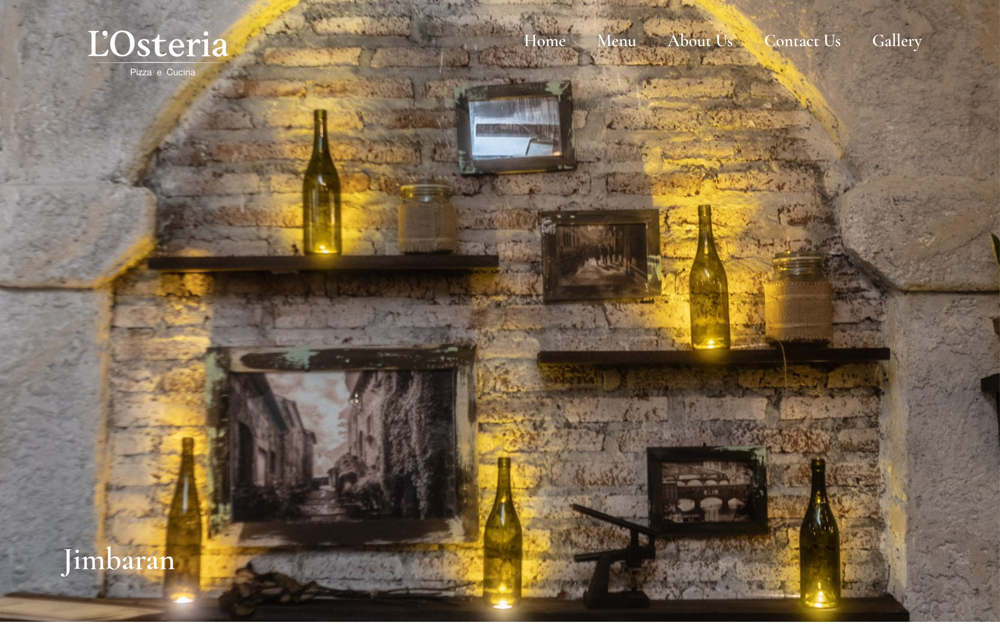

# losteriapizzaecucina DESIGN.md

> Auto-generated design system — reverse-engineered via static analysis by skillui.
> Frameworks: None detected
> Colors: 20 · Fonts: 3 · Components: 8
> Icon library: not detected · State: not detected
> Primary theme: light · Dark mode toggle: no · Motion: expressive

## Visual Reference

**Match this design exactly** — study colors, fonts, spacing, and component shapes before writing any UI code.



---

## 1. Visual Theme & Atmosphere

This is a **light-themed** interface with a cool, approachable feel. The light background emphasizes content clarity. Typography pairs **Roboto** for display/headings with **Roboto Slab** for body text, creating clear visual hierarchy through type contrast. Spacing follows a **5px base grid** (standard density), with scale: 5, 10, 15, 20, 25, 30, 35, 40px. The accent color **#9460ff** anchors interactive elements (buttons, links, focus rings). Motion is expressive — spring physics, layout animations, and staggered reveals are part of the visual language.

---

## 2. Color Palette & Roles

| Token | Hex | Role | Use |
|---|---|---|---|
| background | `#eeeeee` | background | Page background, darkest surface |
| surface | `#f9efdc` | surface | Card and panel backgrounds |
| wp--preset--color--black | `#000000` | text-primary | Headings and body text |
| e-form-steps-indicator-inactive-secondary-color | `#ffffff` | text-muted | Captions, placeholders, secondary info |
| text-muted | `#494c4f` | text-muted | Captions, placeholders, secondary info |
| e-global-color-secondary | `#55595c` | text-muted | Captions, placeholders, secondary info |
| border | `#333333` | border | Dividers, card borders, outlines |
| accent | `#9460ff` | accent | CTAs, links, focus rings, active states |
| danger | `#fe8f75` | danger | Error states, destructive actions |
| success | `#53f8a2` | success | Success states, positive indicators |
| info | `#2575fc` | info | Informational highlights |
| e-global-color-ed889b2 | `#69727d` | unknown | Palette color |
| divider-color | `#d5d5d5` | unknown | Palette color |
| n-menu-title-color-normal | `#1f2124` | unknown | Palette color |
| e-global-color-primary | `#6ec1e4` | unknown | Palette color |
| unknown | `#4285f4` | unknown | Palette color |
| unknown | `#f2709c` | unknown | Palette color |
| e-global-color-text | `#7a7a7a` | unknown | Palette color |
| unknown | `#ff712b` | unknown | Palette color |
| unknown | `#00e49a` | unknown | Palette color |

### CSS Variable Tokens

```css
--border-radius: 0;
--border-top-width: 0px;
--border-right-width: 0px;
--border-bottom-width: 0px;
--border-left-width: 0px;
--border-style: initial;
--border-color: initial;
--border-block-start-width: var(--border-top-width);
--border-block-end-width: var(--border-bottom-width);
--border-inline-start-width: var(--border-left-width);
--border-inline-end-width: var(--border-right-width);
--border-inline-start-width: var(--border-right-width);
--border-inline-end-width: var(--border-left-width);
--e-global-color-primary: #6EC1E4;
--e-global-color-secondary: #54595F;
--e-global-color-accent: #61CE70;
--e-global-typography-primary-font-family: "Roboto";
--e-global-typography-primary-font-weight: 600;
--e-global-typography-secondary-font-family: "Roboto Slab";
--e-global-typography-secondary-font-weight: 400;
```


---

## 3. Typography Rules

**Font Stack:**
- **Roboto Slab** — Heading 1, Heading 2, Heading 3
- **Roboto** — Body, Caption
- **Courier New** — Code

**Font Sources:**

```css
@font-face {
  font-family: "eicons";
  src: url("fonts/eicons-Regular.woff2") format("woff2");
  font-weight: 400;
}
@font-face {
  font-family: "Roboto";
  src: url("fonts/Roboto-Bold.ttf") format("truetype");
  font-weight: 700;
}
@font-face {
  font-family: "Roboto";
  src: url("fonts/Roboto-Regular.ttf") format("truetype");
  font-weight: 400;
}
@font-face {
  font-family: "Roboto Slab";
  src: url("fonts/RobotoSlab-Bold.ttf") format("truetype");
  font-weight: 700;
}
@font-face {
  font-family: "Roboto Slab";
  src: url("fonts/RobotoSlab-Regular.ttf") format("truetype");
  font-weight: 400;
}
@font-face {
  font-family: "Cormorant Garamond";
  src: url("fonts/CormorantGaramond-Bold.ttf") format("truetype");
  font-weight: 700;
}
@font-face {
  font-family: "Cormorant Garamond";
  src: url("fonts/CormorantGaramond-Regular.ttf") format("truetype");
  font-weight: 400;
}
@font-face {
  font-family: "elementskit";
  src: url("fonts/elementskit-Regular.woff") format("woff");
  font-weight: 400;
}
```

| Role | Font | Size | Weight |
|---|---|---|---|
| Heading 1 | Roboto Slab | 132px | 700 |
| Heading 2 | Roboto Slab | 100px | 700 |
| Heading 3 | Roboto Slab | 90px | 700 |
| Body | Roboto | 14px | 400 |
| Caption | Roboto | 18px | 400 |
| Code | Courier New | 14px | 400 |

**Typographic Rules:**
- Limit to 3 font families max per screen
- Use **Roboto Slab** for body/UI text, **Roboto** for display/headings
- Maintain consistent hierarchy: no more than 3-4 font sizes per screen
- Headings use bold (600-700), body uses regular (400)
- Line height: 1.5 for body text, 1.2 for headings
- Use color and opacity for secondary hierarchy, not additional font sizes


---

## 4. Component Stylings

### Layout (1)

**Footer** — `html`

### Navigation (1)

**Navigation** — `html`

### Data Display (1)

**Badge** — `html`

### Data Input (2)

**Button** — `html`
- Animation: 

**Input** — `html`
- State: :focus, :placeholder

### Overlay (1)

**Modal** — `html`

### Media (2)

**Image** — `html`

**Map/Canvas** — `html`


---

## 5. Layout Principles

- **Base spacing unit:** 5px
- **Spacing scale:** 5, 10, 15, 20, 25, 30, 35, 40, 45, 50, 55, 60
- **Border radius:** .1em, .25rem, .5em, 2px, 2rem, 3px, 4px, 4.32px, 5px, 6px, 10em, 10%, 10px, 14px, 15px, 17.5px, 20px, 25px, 30px, 50px, 100%, 100em, 100px, 1000px, inherit
- **Max content width:** 1024px

**Spacing as Meaning:**
| Spacing | Use |
|---|---|
| 2.5-5px | Tight: related items within a group |
| 10px | Medium: between groups |
| 15-20px | Wide: between sections |
| 30px+ | Vast: major section breaks |


---

## 6. Depth & Elevation

### Flat — subtle depth hints

- `inset 0 0 0 1px rgba(0,0,0,.1)`
- `inset 0-1px 0 rgba(0,0,0,.102)`
- `inset 0 0 0 1px currentColor`

### Raised — cards, buttons, interactive elements

- `0 .35rem 0 currentColor`
- `var(--n-menu-dropdown-content-box-shadow-horizontal) var(--n-menu-dropdown-content-box-shadow-vertical) var(--n-menu-dropdown-content-box-shadow-blur) var(--n-menu-dropdown-content-box-shadow-spread) var(--n-menu-dropdown-content-box-shadow-color) var(--n-menu-dropdown-content-box-shadow-position, )`
- `0 0 8px rgba(0,0,0,.6)`

### Floating — dropdowns, popovers, modals

- `0 4px 10px -2px rgba(0,0,0,0.1)`
- `0 0 12px rgba(51,51,51,.5)`
- `0 3px 0#fff,0 0 12px rgba(51,51,51,.5)`

### Overlay — full-screen overlays, top-level dialogs

- `0 10px 30px 0 rgba(45,45,45,.2)`
- `0 10px 30px 0 rgba(255,165,0,0)`
- `0 10px 25px rgba(0,0,0,.1)`

### Z-Index Scale

`0, 1, 2, 3, 5, 6, 9, 10, 11, 12, 14, 16, 20, 21, 25, 30, 40, 50, 99, 100, 101, 102, 150, 160, 999, 1000, 1002, 1044, 1045, 1046, 1070, 1111, 2001, 2002, 9997, 9999, 10000, 90000, 99999, 100000, 999998, 999999, 2147483620, 2147483640`


---

## 7. Animation & Motion

This project uses **expressive motion**. Animations are an integral part of the experience.

### CSS Animations

- `@keyframes a`
- `@keyframes eicon-spin`
- `@keyframes fadeInUp`
- `@keyframes fadeIn`
- `@keyframes fa-spin`
- `@keyframes hide-scroll`
- `@keyframes ekit_ajax_spinner_rotation`
- `@keyframes xs-zoomIn`

### Animated Components

- **Button**: 

### Motion Guidelines

- Duration: 150-300ms for micro-interactions, 300-500ms for page transitions
- Easing: `ease-out` for enters, `ease-in` for exits
- Always respect `prefers-reduced-motion`


---

## 8. Do's and Don'ts

### Do's

- Use `#9460ff` for interactive elements (buttons, links, focus rings)
- Use `#eeeeee` as the primary page background
- Pair **Roboto Slab** (body) with **Roboto** (display) — these are the only allowed fonts
- Follow the **5px** spacing grid for all margins, padding, and gaps
- Use the defined shadow tokens for elevation — see Section 6
- Use border-radius from the scale: .1em, .25rem, .5em, 2px, 2rem
- Reuse existing components from Section 4 before creating new ones

### Don'ts

- Don't introduce colors outside this palette — extend the design tokens first
- Don't introduce additional font families beyond Roboto Slab and Roboto and Courier New
- Don't use arbitrary spacing values — stick to multiples of 5px
- Don't create custom box-shadow values outside the system tokens
- Don't use arbitrary border-radius values — pick from the defined scale
- Don't duplicate component patterns — check Section 4 first
- Don't use backdrop-blur or blur effects

### Anti-Patterns (detected from codebase)

- No blur or backdrop-blur effects
- No zebra striping on tables/lists


---

## 9. Responsive Behavior

| Name | Value | Source |
|---|---|---|
| xs | 320px | css |
| xs | 411px | css |
| xs | 479px | css |
| xs | 480px | css |
| sm | 481px | css |
| sm | 568px | css |
| sm | 575px | css |
| sm | 576px | css |
| sm | 640px | css |
| md | 766px | css |
| md | 767px | css |
| md | 768px | css |
| lg | 800px | css |
| lg | 900px | css |
| lg | 991px | css |
| lg | 992px | css |
| lg | 1023px | css |
| lg | 1024px | css |
| xl | 1025px | css |
| xl | 1199px | css |
| xl | 1200px | css |
| 2xl | 99999px | css |

**Approach:** Use `@media (min-width: ...)` queries matching the breakpoints above.


---

## 10. Agent Prompt Guide

Use these as starting points when building new UI:

### Build a Card

```
Background: #f9efdc
Border: 1px solid #333333
Radius: 10px
Padding: 20px
Font: Roboto Slab
Use shadow tokens from Section 6.
```

### Build a Button

```
Primary: bg #9460ff, text white
Ghost: bg transparent, border #333333
Padding: 10px 20px
Radius: 10px
Hover: opacity 0.9 or lighter shade
Focus: ring with #9460ff
```

### Build a Page Layout

```
Background: #eeeeee
Max-width: 1024px, centered
Grid: 5px base
Responsive: mobile-first, breakpoints from Section 9
```

### Build a Stats Card

```
Surface: #f9efdc
Label: #ffffff (muted, 12px, uppercase)
Value: #000000 (primary, 24-32px, bold)
Status: use success/warning/danger from Section 2
```

### Build a Form

```
Input bg: #eeeeee
Input border: 1px solid #333333
Focus: border-color #9460ff
Label: #ffffff 12px
Spacing: 20px between fields
Radius: 10px
```

### General Component

```
1. Read DESIGN.md Sections 2-6 for tokens
2. Colors: only from palette
3. Font: Roboto Slab, type scale from Section 3
4. Spacing: 5px grid
5. Components: match patterns from Section 4
6. Elevation: shadow tokens
```
